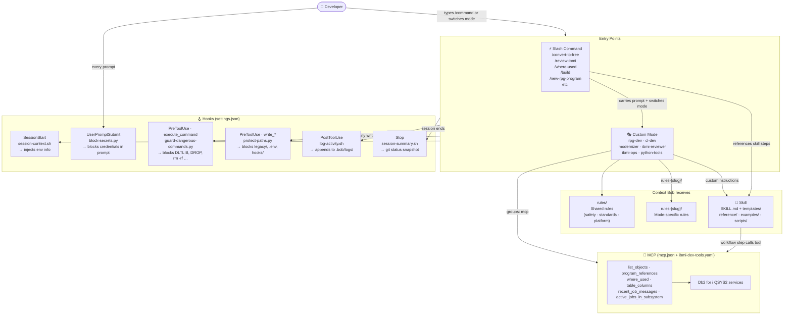
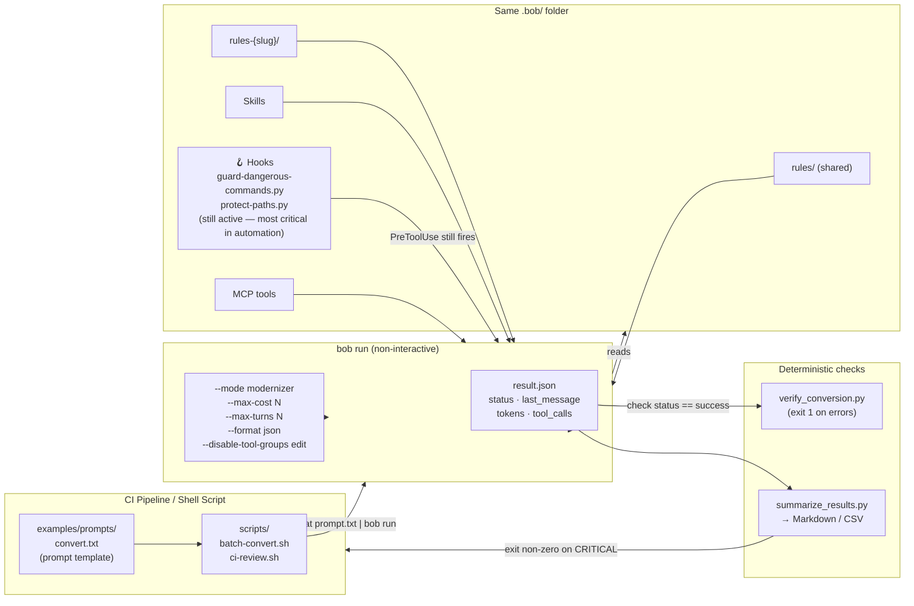
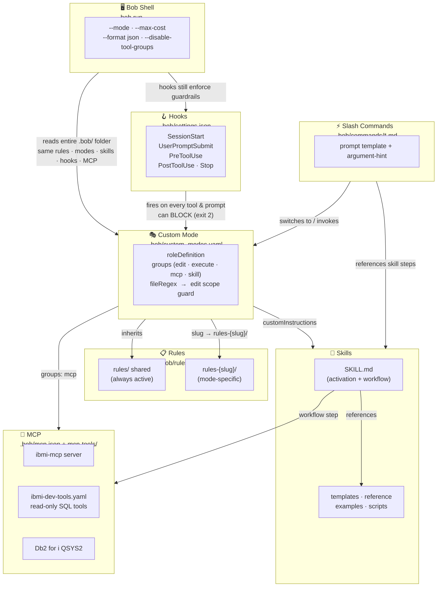

# Bob Architecture — How Everything Connects

> Shows how Custom Modes, Rules, Skills, Commands, Hooks, MCP, and Bob Shell
> all relate to each other in this IBM i project.

---

## Map 1 — Interactive Session (IDE)

---

## Map 2 — Bob Shell (CI / Automation)

---

## Map 3 — The Full Picture

---

## Key Insights

| # | Insight |
|---|---|
| **1** | **Commands are thin wrappers** — they carry a user argument into a mode + skill combination. The actual logic lives in the skill, not the command file. |
| **2** | **Hooks are the safety net that cannot be bypassed** — they fire in Bob Shell automation too, which is exactly when Bob has pre-approved tool calls and the risk is highest. |
| **3** | **Bob Shell shares the entire `.bob/` folder** — rules, modes, skills, and MCP are not IDE-only features; every `bob run` in CI gets the same guardrails a developer gets interactively. |

---

## File Reference

| Layer | Location |
|---|---|
| Custom Modes | [`.bob/custom_modes.yaml`](../.bob/custom_modes.yaml) |
| Shared rules | [`.bob/rules/`](../.bob/rules/) |
| Mode-specific rules | [`.bob/rules-{slug}/`](../.bob/) |
| Skills | [`.bob/skills/`](../.bob/skills/) |
| Slash commands | [`.bob/commands/`](../.bob/commands/) |
| Hooks config | [`.bob/settings.json`](../.bob/settings.json) |
| Hook scripts | [`.bob/hooks/`](../.bob/hooks/) |
| MCP config | [`.bob/mcp.json`](../.bob/mcp.json) |
| MCP tool definitions | [`.bob/mcp-tools/ibmi-dev-tools.yaml`](../.bob/mcp-tools/ibmi-dev-tools.yaml) |
| Bob Shell scripts | [`.bob/skills/bob-shell-automation/scripts/`](../.bob/skills/bob-shell-automation/scripts/) |
