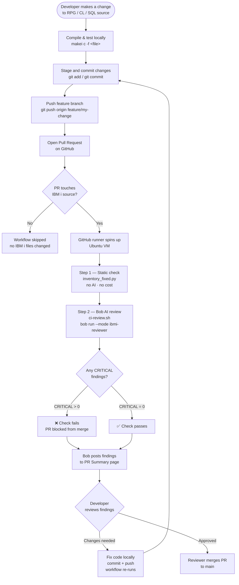

# Pull Request Review Gate — Developer Guide

> **Audience:** Developers new to the IBM i git workflow and the Bob AI review process.  
> **What this covers:** How a code change travels from your workstation to a reviewed, merged PR — using the command line, VS Code, and Bob Shell.

---

## End-to-End Flow



---

## Prerequisites

Before your first PR, make sure these are in place (one-time setup per repo):

| # | What | Where to check |
|---|------|----------------|
| 1 | Git installed and configured | `git --version` in a terminal |
| 2 | GitHub repo cloned locally | `git remote -v` should show `origin` |
| 3 | Bob Shell installed | `bob --version` in a terminal |
| 4 | `BOB_API_KEY` in your environment | `echo $BOB_API_KEY` (Linux/Mac) or `$env:BOB_API_KEY` (PowerShell) |
| 5 | `bob-review.yml` exists in `.github/workflows/` on `main` | Browse repo on GitHub |
| 6 | `BOB_API_KEY` added as a GitHub Actions secret | GitHub → repo → Settings → Secrets and variables → Actions |

---

## Step 1 — Create a Feature Branch

Never commit directly to `main`. Always work on a named branch.

### Git CLI
```bash
# Make sure you are up to date first
git checkout main
git pull origin main

# Create and switch to your feature branch
git checkout -b feature/my-change
```

### VS Code
1. Click the branch name in the **bottom-left status bar** (shows `main`)
2. Select **Create new branch…**
3. Type `feature/my-change` → press Enter
4. VS Code switches to the new branch automatically

### Bob Shell
Bob Shell does not manage branches directly — use the git CLI or VS Code for this step.

---

## Step 2 — Make Your Changes

Edit RPG, CL, or SQL source files in `qrpglesrc/`, `qcllesrc/`, or `qsqlsrc/`.

> **Key rules to avoid CRITICAL findings in the review:**
> - No hard-coded library names — rely on the library list
> - Always check `SQLSTATE` after every SQL statement in SQLRPGLE
> - No `DROP`, `DELETE` without `WHERE`, or `TRUNCATE` — these are blocked by hooks
> - New columns in DDL must have a `DEFAULT`
> - Every source must start with a header comment (object name, purpose, author, date)

### Compile locally before committing

This catches syntax errors before the PR is even opened:

```bash
makei c -f qrpglesrc/mycustpgm.pgm.rpgle
```

Fix any errors reported before moving on.

---

## Step 3 — Stage and Commit Your Changes

### Git CLI
```bash
# See what changed
git status

# Stage the files you changed
git add qrpglesrc/mycustpgm.pgm.rpgle

# Or stage everything changed (use with care)
git add .

# Commit with a meaningful message
git commit -m "feat: add customer balance check to MYCUSTPGM"
```

**Good commit message format:** `type: short description`  
Examples: `fix: correct SQLSTATE check in order header read`, `feat: add discount calculation`

### VS Code
1. Click the **Source Control** icon in the left sidebar (the branching icon, or `Ctrl+Shift+G`)
2. You will see your changed files listed under **Changes**
3. Hover over a file and click **+** to stage it (moves it to **Staged Changes**)
4. Type your commit message in the text box at the top
5. Click the **✓ Commit** button (or press `Ctrl+Enter`)

### Bob Shell
Bob Shell does not run git commands — use the CLI or VS Code for commits.

---

## Step 4 — Push Your Branch to GitHub

### Git CLI
```bash
# Push the branch (first time — sets the upstream)
git push -u origin feature/my-change

# Subsequent pushes on the same branch
git push
```

### VS Code
1. In the **Source Control** panel, click the **…** menu → **Push**
2. Or click the **↑ Sync Changes** button that appears in the bottom status bar after committing
3. If prompted to publish the branch, click **OK / Publish Branch**

---

## Step 5 — Open the Pull Request on GitHub

1. Go to your repository on **github.com**
2. GitHub will show a yellow banner: *"feature/my-change had recent pushes"* → click **Compare & pull request**
3. Fill in:
   - **Title:** short description of what changed (e.g. `Add customer balance check`)
   - **Description:** what you changed, why, and any testing notes
4. Make sure the **base branch** is `main` and the **compare branch** is your feature branch
5. Click **Create pull request**

> The Bob review workflow fires **automatically** the moment the PR is created — you do not need to trigger it manually.

---

## Step 6 — Monitor the Review

### Where to watch it run

On the PR page, scroll down to the **Checks** section. You will see:

| Check | What it does |
|-------|-------------|
| **Static fixed-format check** | Runs `inventory_fixed.py` — no AI, instant results |
| **Bob review gate** | Runs Bob AI review — takes 1–3 minutes depending on file count |

Click **Details** next to any check to see live logs.

### Where the findings appear

Click the **Summary** tab on the workflow run page (or scroll to the bottom of the PR checks area). Bob posts a Markdown report showing:

- Every finding with **Severity** (CRITICAL / HIGH / MEDIUM / LOW)
- **File and line number** for each finding
- **Why it matters on IBM i**
- A **suggested fix** with code snippet
- A summary table and overall **VERDICT**

---

## Step 7 — Respond to Findings

### If the check passes (CRITICAL = 0)
The PR is unblocked. A human reviewer can now review and merge. You may still want to address HIGH or MEDIUM findings before merge — that is a team decision.

### If the check fails (CRITICAL > 0)
The PR is blocked from merging until the critical issues are fixed.

**Typical fix cycle:**

```bash
# 1. Read Bob's findings in the PR Summary tab on GitHub
# 2. Fix the issue in your local source
# 3. Recompile to confirm no syntax errors
makei c -f qrpglesrc/mycustpgm.pgm.rpgle

# 4. Commit the fix
git add qrpglesrc/mycustpgm.pgm.rpgle
git commit -m "fix: add SQLSTATE check after customer read"

# 5. Push — the workflow runs again automatically
git push
```

The review workflow re-runs on every push to the PR branch.

---

## Running the Review Locally (Optional)

You can run the same review Bob runs in CI before pushing, to catch issues early. This requires Bob Shell and `BOB_API_KEY` in your environment.

### Bob Shell — review a single file
```bash
bob run --mode ibmi-reviewer \
        --disable-tool-groups edit,execute \
        --max-cost 2 --max-turns 30 \
        "Review @qrpglesrc/mycustpgm.pgm.rpgle against the shop checklist in .bob/rules-ibmi-reviewer/01-review-checklist.md. Do not modify any files."
```

### Bob Shell — run the full CI review script against your branch
```bash
export BOB_API_KEY=your_key_here
bash .bob/skills/bob-shell-automation/scripts/ci-review.sh origin/main
```

This produces `reviews/ci-review.md` locally — the same report the workflow would post to GitHub.

### Bob interactive chat — quick review before committing
In VS Code with Bob open, switch to **🔍 IBM i Reviewer** mode and ask:

> *Review `@qrpglesrc/mycustpgm.pgm.rpgle` for any CRITICAL or HIGH issues before I raise a PR.*

Bob will check it against the shop rules interactively.

---

## Quick Reference — Git Commands Cheat Sheet

```bash
# Daily start — sync with main
git checkout main && git pull origin main

# New branch
git checkout -b feature/<ticket>-<short-description>

# Check what is staged / unstaged
git status

# Stage specific file
git add <path/to/file>

# Commit
git commit -m "type: description"

# Push (first time)
git push -u origin feature/<name>

# Push (subsequent)
git push

# See commits on your branch vs main
git log origin/main..HEAD --oneline

# Discard unstaged changes to a file (careful — cannot be undone)
git checkout -- <path/to/file>

# Update your branch with latest main (before raising PR)
git fetch origin
git rebase origin/main
```

---

## Common Problems

| Symptom | Likely cause | Fix |
|---------|-------------|-----|
| Workflow does not trigger | PR does not touch `*.rpgle`, `*.clle`, etc. | Expected — workflow only runs for IBM i source changes |
| Workflow does not exist | `bob-review.yml` not on `main` yet | Merge the setup PR to `main` first |
| `BOB_API_KEY` error in logs | Secret not added to repo | GitHub → Settings → Secrets → Actions → add `BOB_API_KEY` |
| Bob review step fails immediately | `ci-review.sh` not found | Confirm `.bob/skills/bob-shell-automation/scripts/ci-review.sh` exists on the branch |
| CRITICAL: hard-coded library | Library name in source code | Replace with a named constant or rely on the library list |
| CRITICAL: SQL injection risk | String concatenation in SQL | Use host variables / parameter markers instead |
